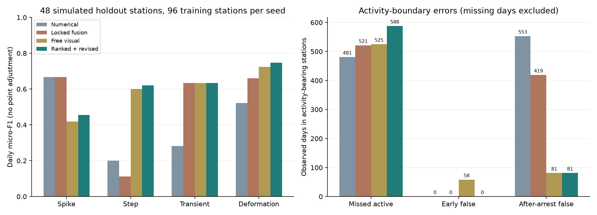

# GNSS-VLM-EXP03-v2：GNSS排序候选视觉确认、可修正活动边界与训练规模对照实验

范围：two-independent-simulated-test-seeds-48-stations。主方法ranked_boundary_fusion，旧主方法anchored_fusion；相同视觉响应派生，非独立调用。

| 批次 | 训练站 | 方法 | 通用日F1 | 形变日F1 | 形变事件F1≥.5 | 尖峰日F1 | 阶跃日F1 | 失败站 |
|---|---:|---|---:|---:|---:|---:|---:|---:|
| exp03-main-v2-recovered | 96 | random_forest | 0.5362 | 0.5634 | 0.0000 | 0.4000 | 0.0000 | 0/24 |
| exp03-main-v2-recovered | 96 | rf_balanced | 0.5589 | 0.5273 | 0.0000 | 0.7143 | 0.2857 | 0/24 |
| exp03-main-v2-recovered | 96 | extra_trees | 0.5868 | 0.5475 | 0.0000 | 0.4000 | 0.0000 | 0/24 |
| exp03-main-v2-recovered | 96 | isolation_forest | 0.4215 | — | — | — | — | 0/24 |
| exp03-main-v2-recovered | 96 | rf_temporal | 0.6192 | 0.5718 | 0.4444 | 0.7143 | 0.2857 | 0/24 |
| exp03-main-v2-recovered | 96 | rf_split_temporal | 0.6189 | 0.5718 | 0.4444 | 0.6667 | 0.3077 | 0/24 |
| exp03-main-v2-recovered | 96 | visual_only | 0.4215 | 0.3905 | 0.2727 | 0.1429 | 0.0000 | 1/24 |
| exp03-main-v2-recovered | 96 | fusion | 0.3901 | 0.3449 | 0.2500 | 0.1538 | 0.0000 | 1/24 |
| exp03-main-v2-recovered | 96 | guided_fusion | 0.7899 | 0.7549 | 0.8000 | 0.4667 | 0.5882 | 0/24 |
| exp03-main-v2-recovered | 96 | guided_no_local | 0.5969 | 0.5841 | 0.5556 | 0.5926 | 0.3810 | 0/24 |
| exp03-main-v2-recovered | 96 | guided_no_scores | 0.5440 | 0.5380 | 0.5455 | 0.5556 | 0.2105 | 2/24 |
| exp03-main-v2-recovered | 96 | anchored_fusion | 0.6789 | 0.6160 | 0.5714 | 0.6667 | 0.1818 | 0/24 |
| exp03-main-v2-recovered | 96 | boundary_fusion | 0.7738 | 0.7301 | 0.8571 | 0.6667 | 0.1818 | 0/24 |
| exp03-main-v2-recovered | 96 | boundary_numeric_points | 0.7741 | 0.7301 | 0.8571 | 0.6667 | 0.3077 | 0/24 |
| exp03-main-v2-recovered | 96 | ranked_boundary_fusion | 0.7728 | 0.7301 | 0.8571 | 0.5185 | 0.6250 | 0/24 |
| exp03-main-v2-recovered | 96 | ranked_no_local | 0.6535 | 0.6499 | 0.6154 | 0.6154 | 0.5333 | 0/24 |
| exp03-main-v2-recovered | 96 | ranked_no_scores | 0.7109 | 0.7391 | 0.7143 | 0.7692 | 0.3077 | 2/24 |
| exp03-main-v2-recovered | 96 | visualtime_gnss | 0.0000 | — | — | — | — | 24/24 |
| exp03-seed2026101208-v2 | 96 | random_forest | 0.6699 | 0.6489 | 0.0196 | 0.4444 | 0.0000 | 0/24 |
| exp03-seed2026101208-v2 | 96 | rf_balanced | 0.5393 | 0.4540 | 0.0063 | 0.6154 | 0.2500 | 0/24 |
| exp03-seed2026101208-v2 | 96 | extra_trees | 0.6509 | 0.6342 | 0.0250 | 0.4444 | 0.0000 | 0/24 |
| exp03-seed2026101208-v2 | 96 | isolation_forest | 0.4495 | — | — | — | — | 0/24 |
| exp03-seed2026101208-v2 | 96 | rf_temporal | 0.5651 | 0.4892 | 0.6957 | 0.6154 | 0.2500 | 0/24 |
| exp03-seed2026101208-v2 | 96 | rf_split_temporal | 0.5649 | 0.4892 | 0.6957 | 0.6667 | 0.0000 | 0/24 |
| exp03-seed2026101208-v2 | 96 | fusion | 0.2918 | 0.2233 | 0.1429 | 0.2000 | 0.0000 | 1/24 |
| exp03-seed2026101208-v2 | 96 | guided_fusion | 0.7268 | 0.6900 | 0.6667 | 0.3750 | 0.6154 | 0/24 |
| exp03-seed2026101208-v2 | 96 | anchored_fusion | 0.7252 | 0.7006 | 0.8750 | 0.6667 | 0.0000 | 0/24 |
| exp03-seed2026101208-v2 | 96 | boundary_fusion | 0.7743 | 0.7661 | 0.7500 | 0.6667 | 0.0000 | 0/24 |
| exp03-seed2026101208-v2 | 96 | boundary_numeric_points | 0.7743 | 0.7661 | 0.7500 | 0.6667 | 0.0000 | 0/24 |
| exp03-seed2026101208-v2 | 96 | ranked_boundary_fusion | 0.7703 | 0.7661 | 0.7500 | 0.4000 | 0.6154 | 0/24 |

## 成对差值

形变日micro-F1，种子内站点bootstrap 2000次；条件于已拟合模型。

- ranked_boundary_fusion − anchored_fusion：+0.0873，95%CI [-0.0355, 0.2027]。
- ranked_boundary_fusion − boundary_fusion：+0.0000，95%CI [0.0000, 0.0000]。
- ranked_boundary_fusion − guided_fusion：+0.0239，95%CI [-0.0383, 0.1031]。
- ranked_boundary_fusion − rf_split_temporal：+0.2258，95%CI [0.0890, 0.3632]。
- ranked_boundary_fusion − random_forest：+0.1408，95%CI [0.0663, 0.2335]。
- ranked_boundary_fusion − rf_balanced：+0.2623，95%CI [0.1479, 0.3908]。
- ranked_boundary_fusion − fusion：+0.4702，95%CI [0.3416, 0.5925]。
- ranked_boundary_fusion − boundary_numeric_points：+0.0000，95%CI [0.0000, 0.0000]。

## 两种子合并（共同方法）

| 方法 | 形变日F1 | 形变事件F1≥.5 | 尖峰日F1 | 阶跃日F1 | 暂态日F1 |
|---|---:|---:|---:|---:|---:|
| anchored_fusion | 0.6601 | 0.7333 | 0.6667 | 0.1111 | 0.6346 |
| boundary_fusion | 0.7474 | 0.8000 | 0.6667 | 0.1111 | 0.6346 |
| boundary_numeric_points | 0.7474 | 0.8000 | 0.6667 | 0.2000 | 0.6346 |
| extra_trees | 0.5904 | 0.0125 | 0.4211 | 0.0000 | 0.3280 |
| fusion | 0.2772 | 0.1923 | 0.1739 | 0.0000 | 0.2655 |
| guided_fusion | 0.7234 | 0.7273 | 0.4194 | 0.6000 | 0.6346 |
| random_forest | 0.6066 | 0.0114 | 0.4211 | 0.0000 | 0.3163 |
| ranked_boundary_fusion | 0.7474 | 0.8000 | 0.4561 | 0.6207 | 0.6346 |
| rf_balanced | 0.4851 | 0.0038 | 0.6667 | 0.2727 | 0.3160 |
| rf_split_temporal | 0.5216 | 0.5854 | 0.6667 | 0.2000 | 0.2818 |
| rf_temporal | 0.5216 | 0.5854 | 0.6667 | 0.2727 | 0.2818 |

## 同站训练规模对照

- train24 rf_split_temporal：形变日F1 0.5350；阶跃日F1 0.3000。
- train96 rf_split_temporal：形变日F1 0.5216；阶跃日F1 0.2000。
- train24 ranked_boundary_fusion：形变日F1 0.6510；阶跃日F1 0.4286。
- train96 ranked_boundary_fusion：形变日F1 0.7474；阶跃日F1 0.6207。
训练规模改变候选输入并重新调用视觉模型，差值也包含响应随机性；同响应融合消融另列。

全部四类型、±3日辅助及正常误报见CSV；缺测排除，无point adjustment。
开发验证不能充当未见测试；同分布仿真不能证明现场效果。完整论文复现或未运行方法不填成绩。

## 实际取舍与来源

活动站1591个可观测机制活动日：主方法漏588日，数值法漏481日、旧锚定漏521日；
停止后假日主方法81、数值553、旧锚定419。改善平台误报有召回代价。
主方法尖峰TP/FP/FN=13/29/2，阶跃=9/5/6；正常暴露误报1.8308段/站年，
数值法和旧锚定为0。不能只用阶跃或形变F1宣称全部类型最优。
[点分析](point-analysis.json)保存测试后补充的点F1区间及真实训练事件数，非新验证或调参。

主种子去局部图/去分数消融、作者源码原解析/严格适配分别见
[主批报告](../exp03-main-v2/results.md)。作者原解析通用F1=.2662，18/24失败，
是模型替换与GNSS六路适配结果，不是原论文性能复现。
主批原进程中断，恢复仅离线，不补模型调用，不将恢复计第二个独立种子。
本实验已确认376次请求，另至多1次在途状态未知；详细见[audit](audit.json)。
研究判断与下一轮重点见[实际结论](../../docs/exp03-assessment.md)。

