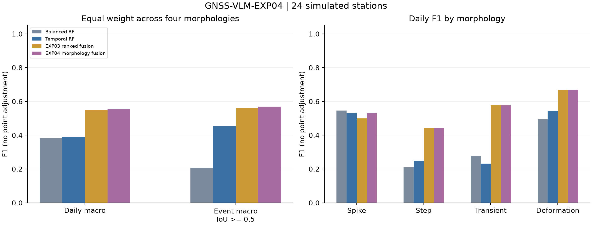

# GNSS-VLM-EXP04：GNSS形态分工视觉数值融合异常识别实验

范围：互斥的6+18验证站，共24站；36次请求含小批信息消融，非正式测试。主方法对应 `morphology_fusion` 行。

先汇总每类全站TP/FP/FN得到F1，再对四类等权平均；日F1与事件F1分列。
失败保留且计零检测，无point adjustment。完整precision/recall、事件IoU≥.3、
尖峰/阶跃±3日容差见comparison.csv及summary.json；所有方法使用同一标准。

| 方法 | 四类等权日F1 | 四类等权事件F1≥.5 | 通用日F1 | 尖峰日F1 | 阶跃日F1 | 暂态日F1 | 形变日F1 | 失败站 |
|---|---:|---:|---:|---:|---:|---:|---:|---:|
| random_forest | 0.2901 | 0.0713 | 0.6674 | 0.2222 | 0.0000 | 0.2544 | 0.6837 | 0/24 |
| rf_balanced | 0.3816 | 0.2073 | 0.5688 | 0.5455 | 0.2105 | 0.2764 | 0.4940 | 0/24 |
| extra_trees | 0.2248 | 0.0217 | 0.6487 | 0.0000 | 0.0000 | 0.2236 | 0.6756 | 0/24 |
| isolation_forest | — | — | 0.5251 | — | — | — | — | 0/24 |
| rf_split_temporal | 0.3897 | 0.4533 | 0.5931 | 0.5333 | 0.2500 | 0.2324 | 0.5432 | 0/24 |
| guided_fusion | 0.5301 | 0.5348 | 0.5722 | 0.4848 | 0.5263 | 0.5731 | 0.5360 | 1/24 |
| boundary_numeric_points | 0.5074 | 0.5208 | 0.6836 | 0.5333 | 0.2500 | 0.5765 | 0.6697 | 1/24 |
| ranked_boundary_fusion | 0.5477 | 0.5611 | 0.6831 | 0.5000 | 0.4444 | 0.5765 | 0.6697 | 1/24 |
| morphology_fixed_activity | 0.5498 | 0.5694 | 0.6621 | 0.5333 | 0.4444 | 0.5765 | 0.6450 | 1/24 |
| morphology_fusion | 0.5560 | 0.5694 | 0.6856 | 0.5333 | 0.4444 | 0.5765 | 0.6697 | 1/24 |

## 相同站点方法差值

四类等权日F1；种子/批次内站点成对bootstrap 2000次，条件于已拟合模型。

- 主方法 − random_forest：+0.2659，95%CI [0.0830, 0.4295]。
- 主方法 − rf_balanced：+0.1744，95%CI [0.0031, 0.3647]。
- 主方法 − extra_trees：+0.3312，95%CI [0.1422, 0.5046]。
- 主方法 − rf_split_temporal：+0.1663，95%CI [0.0098, 0.3281]。
- 主方法 − guided_fusion：+0.0259，95%CI [-0.0982, 0.1424]。
- 主方法 − boundary_numeric_points：+0.0486，95%CI [-0.0070, 0.1310]。
- 主方法 − ranked_boundary_fusion：+0.0083，95%CI [-0.0698, 0.0952]。
- 主方法 − morphology_fixed_activity：+0.0062，95%CI [-0.0231, 0.0272]。

## 分批结果与消融

| 批次 | 方法 | 四类等权日F1 | 四类等权事件F1≥.5 | 通用日F1 | 尖峰日F1 | 阶跃日F1 | 暂态日F1 | 形变日F1 | 失败站 |
|---|---|---:|---:|---:|---:|---:|---:|---:|---:|
| exp04-small-v1 | random_forest | 0.1910 | 0.0200 | 0.6326 | 0.0000 | 0.0000 | 0.0627 | 0.7013 | 0/6 |
| exp04-small-v1 | rf_balanced | 0.2082 | 0.0814 | 0.4930 | 0.0000 | 0.2500 | 0.1647 | 0.4180 | 0/6 |
| exp04-small-v1 | extra_trees | 0.1830 | 0.0333 | 0.6181 | 0.0000 | 0.0000 | 0.0824 | 0.6498 | 0/6 |
| exp04-small-v1 | isolation_forest | — | — | 0.5573 | — | — | — | — | 0/6 |
| exp04-small-v1 | rf_split_temporal | 0.2471 | 0.2548 | 0.5114 | 0.0000 | 0.4000 | 0.1571 | 0.4313 | 0/6 |
| exp04-small-v1 | guided_fusion | 0.7406 | 0.6333 | 0.7586 | 0.6667 | 0.8000 | 0.8176 | 0.6780 | 0/6 |
| exp04-small-v1 | boundary_numeric_points | 0.4778 | 0.3917 | 0.7587 | 0.0000 | 0.4000 | 0.8333 | 0.6780 | 0/6 |
| exp04-small-v1 | ranked_boundary_fusion | 0.6028 | 0.5167 | 0.7582 | 0.4000 | 0.5000 | 0.8333 | 0.6780 | 0/6 |
| exp04-small-v1 | morphology_fixed_activity | 0.4763 | 0.4167 | 0.6578 | 0.0000 | 0.5000 | 0.8333 | 0.5720 | 0/6 |
| exp04-small-v1 | morphology_fusion | 0.5028 | 0.4167 | 0.7587 | 0.0000 | 0.5000 | 0.8333 | 0.6780 | 0/6 |
| exp04-small-v1 | guided_no_local | 0.5080 | 0.5417 | 0.5626 | 0.0000 | 0.6667 | 0.9529 | 0.4124 | 0/6 |
| exp04-small-v1 | guided_no_scores | 0.2577 | 0.2083 | 0.3558 | 0.0000 | 0.0000 | 0.7738 | 0.2571 | 0/6 |
| exp04-small-v1 | morphology_no_local | 0.5080 | 0.5417 | 0.5646 | 0.0000 | 0.6667 | 0.9529 | 0.4124 | 0/6 |
| exp04-small-v1 | morphology_no_scores | 0.3028 | 0.2500 | 0.5542 | 0.0000 | 0.0000 | 0.7738 | 0.4373 | 0/6 |
| exp04-validation-v1 | random_forest | 0.3442 | 0.0857 | 0.6851 | 0.2857 | 0.0000 | 0.4152 | 0.6758 | 0/18 |
| exp04-validation-v1 | rf_balanced | 0.4427 | 0.2329 | 0.6150 | 0.6667 | 0.1818 | 0.3797 | 0.5426 | 0/18 |
| exp04-validation-v1 | extra_trees | 0.2468 | 0.0185 | 0.6617 | 0.0000 | 0.0000 | 0.3003 | 0.6869 | 0/18 |
| exp04-validation-v1 | isolation_forest | — | — | 0.5126 | — | — | — | — | 0/18 |
| exp04-validation-v1 | rf_split_temporal | 0.4326 | 0.5008 | 0.6482 | 0.6154 | 0.1818 | 0.3101 | 0.6231 | 0/18 |
| exp04-validation-v1 | guided_fusion | 0.4578 | 0.5099 | 0.5146 | 0.4444 | 0.4286 | 0.4611 | 0.4970 | 1/18 |
| exp04-validation-v1 | boundary_numeric_points | 0.4812 | 0.5326 | 0.6542 | 0.6154 | 0.1818 | 0.4611 | 0.6667 | 1/18 |
| exp04-validation-v1 | ranked_boundary_fusion | 0.5195 | 0.5709 | 0.6538 | 0.5217 | 0.4286 | 0.4611 | 0.6667 | 1/18 |
| exp04-validation-v1 | morphology_fixed_activity | 0.5448 | 0.5943 | 0.6638 | 0.6154 | 0.4286 | 0.4611 | 0.6740 | 1/18 |
| exp04-validation-v1 | morphology_fusion | 0.5429 | 0.5943 | 0.6571 | 0.6154 | 0.4286 | 0.4611 | 0.6667 | 1/18 |

分批身份按per-run-metrics.json的run字段读取。合并表只纳入各批共同方法；
主批信息消融不假充完整双种子样本。no_scores仍使用数值选窗。

## 实现身份与解释

RF/ExtraTrees/IsolationForest是sklearn库实现；balanced、特征与时间解码是已披露的
GNSS适配。visual_only是本项目同模型纯视觉对照；guided与两代融合是本项目方法。
上述方法不冒称VisualTimeAnomaly、VLM4TS或TAMA的完整源码复现。
作者原提示/API/原解析与GNSS适配的已执行对照见EXP03报告，未混入此批新站数值。

