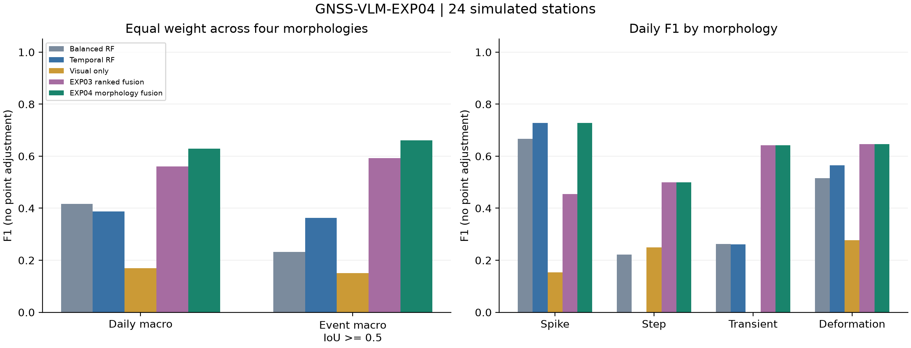

# GNSS-VLM-EXP04：GNSS形态分工视觉数值融合异常识别实验

范围：第二个未见数据种子2026101303的24个模拟测试站，冻结v1。主方法对应 `morphology_fusion` 行。

先汇总每类全站TP/FP/FN得到F1，再对四类等权平均；日F1与事件F1分列。
失败保留且计零检测，无point adjustment。完整precision/recall、事件IoU≥.3、
尖峰/阶跃±3日容差见comparison.csv及summary.json；所有方法使用同一标准。

| 方法 | 四类等权日F1 | 四类等权事件F1≥.5 | 通用日F1 | 尖峰日F1 | 阶跃日F1 | 暂态日F1 | 形变日F1 | 失败站 |
|---|---:|---:|---:|---:|---:|---:|---:|---:|
| random_forest | 0.3816 | 0.1863 | 0.5297 | 0.7273 | 0.0000 | 0.2381 | 0.5609 | 0/24 |
| rf_balanced | 0.4167 | 0.2316 | 0.5162 | 0.6667 | 0.2222 | 0.2618 | 0.5161 | 0/24 |
| extra_trees | 0.3282 | 0.1552 | 0.5074 | 0.6000 | 0.0000 | 0.1626 | 0.5502 | 0/24 |
| isolation_forest | — | — | 0.3816 | — | — | — | — | 0/24 |
| rf_split_temporal | 0.3881 | 0.3634 | 0.5473 | 0.7273 | 0.0000 | 0.2607 | 0.5645 | 0/24 |
| visual_only | 0.1701 | 0.1510 | 0.2856 | 0.1538 | 0.2500 | 0.0000 | 0.2766 | 2/24 |
| guided_fusion | 0.5727 | 0.5846 | 0.7616 | 0.4348 | 0.5000 | 0.6423 | 0.7136 | 0/24 |
| boundary_numeric_points | 0.5039 | 0.5360 | 0.6773 | 0.7273 | 0.0000 | 0.6423 | 0.6459 | 0/24 |
| ranked_boundary_fusion | 0.5607 | 0.5928 | 0.6772 | 0.4545 | 0.5000 | 0.6423 | 0.6459 | 0/24 |
| morphology_fixed_activity | 0.6226 | 0.5985 | 0.7083 | 0.7273 | 0.5000 | 0.6423 | 0.6208 | 0/24 |
| morphology_fusion | 0.6289 | 0.6610 | 0.6807 | 0.7273 | 0.5000 | 0.6423 | 0.6459 | 0/24 |

## 相同站点方法差值

四类等权日F1；种子/批次内站点成对bootstrap 2000次，条件于已拟合模型。

- 主方法 − random_forest：+0.2473，95%CI [0.0724, 0.4027]。
- 主方法 − rf_balanced：+0.2122，95%CI [0.0641, 0.3416]。
- 主方法 − extra_trees：+0.3007，95%CI [0.1558, 0.4571]。
- 主方法 − rf_split_temporal：+0.2407，95%CI [0.0825, 0.3825]。
- 主方法 − visual_only：+0.4587，95%CI [0.2101, 0.6547]。
- 主方法 − guided_fusion：+0.0562，95%CI [-0.0408, 0.1413]。
- 主方法 − boundary_numeric_points：+0.1250，95%CI [0.0000, 0.2000]。
- 主方法 − ranked_boundary_fusion：+0.0682，95%CI [-0.0076, 0.1375]。
- 主方法 − morphology_fixed_activity：+0.0063，95%CI [-0.0152, 0.0314]。

## 分批结果与消融

| 批次 | 方法 | 四类等权日F1 | 四类等权事件F1≥.5 | 通用日F1 | 尖峰日F1 | 阶跃日F1 | 暂态日F1 | 形变日F1 | 失败站 |
|---|---|---:|---:|---:|---:|---:|---:|---:|---:|
| exp04-seed2026101303-v1 | random_forest | 0.3816 | 0.1863 | 0.5297 | 0.7273 | 0.0000 | 0.2381 | 0.5609 | 0/24 |
| exp04-seed2026101303-v1 | rf_balanced | 0.4167 | 0.2316 | 0.5162 | 0.6667 | 0.2222 | 0.2618 | 0.5161 | 0/24 |
| exp04-seed2026101303-v1 | extra_trees | 0.3282 | 0.1552 | 0.5074 | 0.6000 | 0.0000 | 0.1626 | 0.5502 | 0/24 |
| exp04-seed2026101303-v1 | isolation_forest | — | — | 0.3816 | — | — | — | — | 0/24 |
| exp04-seed2026101303-v1 | rf_split_temporal | 0.3881 | 0.3634 | 0.5473 | 0.7273 | 0.0000 | 0.2607 | 0.5645 | 0/24 |
| exp04-seed2026101303-v1 | visual_only | 0.1701 | 0.1510 | 0.2856 | 0.1538 | 0.2500 | 0.0000 | 0.2766 | 2/24 |
| exp04-seed2026101303-v1 | guided_fusion | 0.5727 | 0.5846 | 0.7616 | 0.4348 | 0.5000 | 0.6423 | 0.7136 | 0/24 |
| exp04-seed2026101303-v1 | boundary_numeric_points | 0.5039 | 0.5360 | 0.6773 | 0.7273 | 0.0000 | 0.6423 | 0.6459 | 0/24 |
| exp04-seed2026101303-v1 | ranked_boundary_fusion | 0.5607 | 0.5928 | 0.6772 | 0.4545 | 0.5000 | 0.6423 | 0.6459 | 0/24 |
| exp04-seed2026101303-v1 | morphology_fixed_activity | 0.6226 | 0.5985 | 0.7083 | 0.7273 | 0.5000 | 0.6423 | 0.6208 | 0/24 |
| exp04-seed2026101303-v1 | morphology_fusion | 0.6289 | 0.6610 | 0.6807 | 0.7273 | 0.5000 | 0.6423 | 0.6459 | 0/24 |

分批身份按per-run-metrics.json的run字段读取。合并表只纳入各批共同方法；
主批信息消融不假充完整双种子样本。no_scores仍使用数值选窗。

## 实现身份与解释

RF/ExtraTrees/IsolationForest是sklearn库实现；balanced、特征与时间解码是已披露的
GNSS适配。visual_only是本项目同模型纯视觉对照；guided与两代融合是本项目方法。
上述方法不冒称VisualTimeAnomaly、VLM4TS或TAMA的完整源码复现。
作者原提示/API/原解析与GNSS适配的已执行对照见EXP03报告，未混入此批新站数值。

