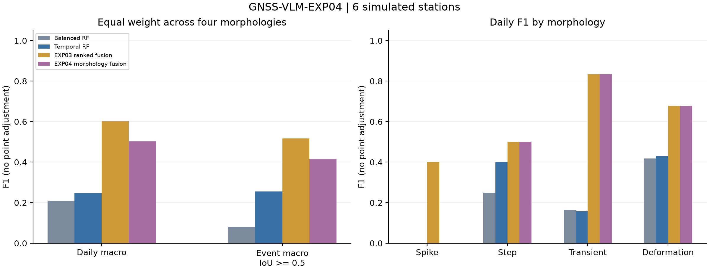

# GNSS-VLM-EXP04：GNSS形态分工视觉数值融合异常识别实验

范围：首6验证站小批，18次请求；开发结果。主方法对应 `morphology_fusion` 行。

先汇总每类全站TP/FP/FN得到F1，再对四类等权平均；日F1与事件F1分列。
失败保留且计零检测，无point adjustment。完整precision/recall、事件IoU≥.3、
尖峰/阶跃±3日容差见comparison.csv及summary.json；所有方法使用同一标准。

| 方法 | 四类等权日F1 | 四类等权事件F1≥.5 | 通用日F1 | 尖峰日F1 | 阶跃日F1 | 暂态日F1 | 形变日F1 | 失败站 |
|---|---:|---:|---:|---:|---:|---:|---:|---:|
| random_forest | 0.1910 | 0.0200 | 0.6326 | 0.0000 | 0.0000 | 0.0627 | 0.7013 | 0/6 |
| rf_balanced | 0.2082 | 0.0814 | 0.4930 | 0.0000 | 0.2500 | 0.1647 | 0.4180 | 0/6 |
| extra_trees | 0.1830 | 0.0333 | 0.6181 | 0.0000 | 0.0000 | 0.0824 | 0.6498 | 0/6 |
| isolation_forest | — | — | 0.5573 | — | — | — | — | 0/6 |
| rf_split_temporal | 0.2471 | 0.2548 | 0.5114 | 0.0000 | 0.4000 | 0.1571 | 0.4313 | 0/6 |
| guided_fusion | 0.7406 | 0.6333 | 0.7586 | 0.6667 | 0.8000 | 0.8176 | 0.6780 | 0/6 |
| boundary_numeric_points | 0.4778 | 0.3917 | 0.7587 | 0.0000 | 0.4000 | 0.8333 | 0.6780 | 0/6 |
| ranked_boundary_fusion | 0.6028 | 0.5167 | 0.7582 | 0.4000 | 0.5000 | 0.8333 | 0.6780 | 0/6 |
| morphology_fixed_activity | 0.4763 | 0.4167 | 0.6578 | 0.0000 | 0.5000 | 0.8333 | 0.5720 | 0/6 |
| morphology_fusion | 0.5028 | 0.4167 | 0.7587 | 0.0000 | 0.5000 | 0.8333 | 0.6780 | 0/6 |
| guided_no_local | 0.5080 | 0.5417 | 0.5626 | 0.0000 | 0.6667 | 0.9529 | 0.4124 | 0/6 |
| guided_no_scores | 0.2577 | 0.2083 | 0.3558 | 0.0000 | 0.0000 | 0.7738 | 0.2571 | 0/6 |
| morphology_no_local | 0.5080 | 0.5417 | 0.5646 | 0.0000 | 0.6667 | 0.9529 | 0.4124 | 0/6 |
| morphology_no_scores | 0.3028 | 0.2500 | 0.5542 | 0.0000 | 0.0000 | 0.7738 | 0.4373 | 0/6 |

## 相同站点方法差值

四类等权日F1；种子/批次内站点成对bootstrap 2000次，条件于已拟合模型。

- 主方法 − random_forest：+0.3118，95%CI [-0.0093, 0.4939]。
- 主方法 − rf_balanced：+0.2947，95%CI [-0.0542, 0.4790]。
- 主方法 − extra_trees：+0.3198，95%CI [0.0064, 0.5025]。
- 主方法 − rf_split_temporal：+0.2557，95%CI [-0.0942, 0.4413]。
- 主方法 − guided_fusion：-0.2377，95%CI [-0.3810, 0.0057]。
- 主方法 − boundary_numeric_points：+0.0250，95%CI [0.0000, 0.1250]。
- 主方法 − ranked_boundary_fusion：-0.1000，95%CI [-0.1667, 0.0000]。
- 主方法 − morphology_fixed_activity：+0.0265，95%CI [0.0000, 0.0516]。
- 主方法 − guided_no_local：-0.0051，95%CI [-0.2381, 0.1482]。
- 主方法 − guided_no_scores：+0.2451，95%CI [0.0050, 0.4309]。
- 主方法 − morphology_no_local：-0.0051，95%CI [-0.2381, 0.1482]。
- 主方法 − morphology_no_scores：+0.2001，95%CI [0.0027, 0.3888]。

## 分批结果与消融

| 方法 | 四类等权日F1 | 四类等权事件F1≥.5 | 通用日F1 | 尖峰日F1 | 阶跃日F1 | 暂态日F1 | 形变日F1 | 失败站 |
|---|---:|---:|---:|---:|---:|---:|---:|---:|
| random_forest | 0.1910 | 0.0200 | 0.6326 | 0.0000 | 0.0000 | 0.0627 | 0.7013 | 0/6 |
| rf_balanced | 0.2082 | 0.0814 | 0.4930 | 0.0000 | 0.2500 | 0.1647 | 0.4180 | 0/6 |
| extra_trees | 0.1830 | 0.0333 | 0.6181 | 0.0000 | 0.0000 | 0.0824 | 0.6498 | 0/6 |
| isolation_forest | — | — | 0.5573 | — | — | — | — | 0/6 |
| rf_split_temporal | 0.2471 | 0.2548 | 0.5114 | 0.0000 | 0.4000 | 0.1571 | 0.4313 | 0/6 |
| guided_fusion | 0.7406 | 0.6333 | 0.7586 | 0.6667 | 0.8000 | 0.8176 | 0.6780 | 0/6 |
| boundary_numeric_points | 0.4778 | 0.3917 | 0.7587 | 0.0000 | 0.4000 | 0.8333 | 0.6780 | 0/6 |
| ranked_boundary_fusion | 0.6028 | 0.5167 | 0.7582 | 0.4000 | 0.5000 | 0.8333 | 0.6780 | 0/6 |
| morphology_fixed_activity | 0.4763 | 0.4167 | 0.6578 | 0.0000 | 0.5000 | 0.8333 | 0.5720 | 0/6 |
| morphology_fusion | 0.5028 | 0.4167 | 0.7587 | 0.0000 | 0.5000 | 0.8333 | 0.6780 | 0/6 |
| guided_no_local | 0.5080 | 0.5417 | 0.5626 | 0.0000 | 0.6667 | 0.9529 | 0.4124 | 0/6 |
| guided_no_scores | 0.2577 | 0.2083 | 0.3558 | 0.0000 | 0.0000 | 0.7738 | 0.2571 | 0/6 |
| morphology_no_local | 0.5080 | 0.5417 | 0.5646 | 0.0000 | 0.6667 | 0.9529 | 0.4124 | 0/6 |
| morphology_no_scores | 0.3028 | 0.2500 | 0.5542 | 0.0000 | 0.0000 | 0.7738 | 0.4373 | 0/6 |

分批身份按per-run-metrics.json的run字段读取。合并表只纳入各批共同方法；
主批信息消融不假充完整双种子样本。no_scores仍使用数值选窗。

## 实现身份与解释

RF/ExtraTrees/IsolationForest是sklearn库实现；balanced、特征与时间解码是已披露的
GNSS适配。visual_only是本项目同模型纯视觉对照；guided与两代融合是本项目方法。
上述方法不冒称VisualTimeAnomaly、VLM4TS或TAMA的完整源码复现。
作者原提示/API/原解析与GNSS适配的已执行对照见EXP03报告，未混入此批新站数值。

