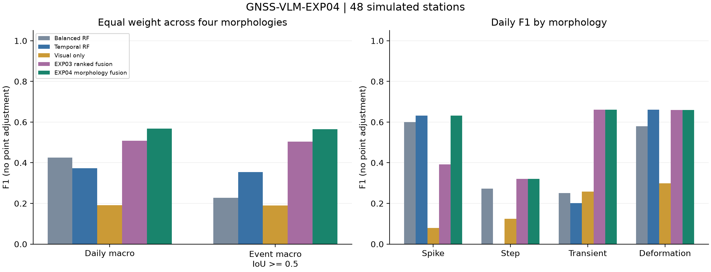

# GNSS-VLM-EXP04：GNSS形态分工视觉数值融合异常识别实验

范围：两个未见种子，共48个独立模拟测试站；主种子24站信息消融单列，冻结v1。主方法对应 `morphology_fusion` 行。

先汇总每类全站TP/FP/FN得到F1，再对四类等权平均；日F1与事件F1分列。
失败保留且计零检测，无point adjustment。完整precision/recall、事件IoU≥.3、
尖峰/阶跃±3日容差见comparison.csv及summary.json；所有方法使用同一标准。

| 方法 | 四类等权日F1 | 四类等权事件F1≥.5 | 通用日F1 | 尖峰日F1 | 阶跃日F1 | 暂态日F1 | 形变日F1 | 失败站 |
|---|---:|---:|---:|---:|---:|---:|---:|---:|
| random_forest | 0.3401 | 0.1510 | 0.5646 | 0.5556 | 0.0000 | 0.1857 | 0.6192 | 0/48 |
| rf_balanced | 0.4257 | 0.2276 | 0.5460 | 0.6000 | 0.2727 | 0.2505 | 0.5795 | 0/48 |
| extra_trees | 0.2821 | 0.0967 | 0.5506 | 0.3750 | 0.0000 | 0.1580 | 0.5955 | 0/48 |
| isolation_forest | — | — | 0.4065 | — | — | — | — | 0/48 |
| rf_split_temporal | 0.3734 | 0.3542 | 0.5695 | 0.6316 | 0.0000 | 0.2010 | 0.6609 | 0/48 |
| visual_only | 0.1907 | 0.1904 | 0.3154 | 0.0800 | 0.1250 | 0.2584 | 0.2992 | 5/48 |
| guided_fusion | 0.5193 | 0.5052 | 0.7232 | 0.3922 | 0.3571 | 0.6614 | 0.6667 | 0/48 |
| boundary_numeric_points | 0.4881 | 0.4846 | 0.7076 | 0.6316 | 0.0000 | 0.6614 | 0.6593 | 0/48 |
| ranked_boundary_fusion | 0.5080 | 0.5045 | 0.7056 | 0.3913 | 0.3200 | 0.6614 | 0.6593 | 0/48 |
| morphology_fixed_activity | 0.5816 | 0.5646 | 0.7734 | 0.6316 | 0.3200 | 0.6614 | 0.7133 | 0/48 |
| morphology_fusion | 0.5681 | 0.5646 | 0.7095 | 0.6316 | 0.3200 | 0.6614 | 0.6593 | 0/48 |

## 相同站点方法差值

四类等权日F1；种子/批次内站点成对bootstrap 2000次，条件于已拟合模型。

- 主方法 − random_forest：+0.2280，95%CI [0.1086, 0.3380]。
- 主方法 − rf_balanced：+0.1424，95%CI [0.0290, 0.2579]。
- 主方法 − extra_trees：+0.2860，95%CI [0.1778, 0.3981]。
- 主方法 − rf_split_temporal：+0.1947，95%CI [0.0905, 0.3063]。
- 主方法 − visual_only：+0.3774，95%CI [0.2219, 0.5140]。
- 主方法 − guided_fusion：+0.0487，95%CI [-0.0440, 0.1327]。
- 主方法 − boundary_numeric_points：+0.0800，95%CI [0.0217, 0.1400]。
- 主方法 − ranked_boundary_fusion：+0.0601，95%CI [-0.0020, 0.1143]。
- 主方法 − morphology_fixed_activity：-0.0135，95%CI [-0.0339, 0.0056]。

## 分批结果与消融

| 批次 | 方法 | 四类等权日F1 | 四类等权事件F1≥.5 | 通用日F1 | 尖峰日F1 | 阶跃日F1 | 暂态日F1 | 形变日F1 | 失败站 |
|---|---|---:|---:|---:|---:|---:|---:|---:|---:|
| exp04-main-v1 | random_forest | 0.2780 | 0.0938 | 0.5938 | 0.2857 | 0.0000 | 0.1543 | 0.6719 | 0/24 |
| exp04-main-v1 | rf_balanced | 0.4241 | 0.2116 | 0.5746 | 0.5000 | 0.3077 | 0.2399 | 0.6487 | 0/24 |
| exp04-main-v1 | extra_trees | 0.1979 | 0.0000 | 0.5869 | 0.0000 | 0.0000 | 0.1553 | 0.6364 | 0/24 |
| exp04-main-v1 | isolation_forest | — | — | 0.4276 | — | — | — | — | 0/24 |
| exp04-main-v1 | rf_split_temporal | 0.3549 | 0.3357 | 0.5917 | 0.5000 | 0.0000 | 0.1444 | 0.7752 | 0/24 |
| exp04-main-v1 | visual_only | 0.1787 | 0.2159 | 0.3439 | 0.0000 | 0.0000 | 0.3937 | 0.3213 | 3/24 |
| exp04-main-v1 | guided_fusion | 0.4764 | 0.4372 | 0.6889 | 0.3571 | 0.2500 | 0.6742 | 0.6241 | 0/24 |
| exp04-main-v1 | boundary_numeric_points | 0.4612 | 0.4259 | 0.7333 | 0.5000 | 0.0000 | 0.6742 | 0.6707 | 0/24 |
| exp04-main-v1 | ranked_boundary_fusion | 0.4580 | 0.4227 | 0.7297 | 0.3333 | 0.1538 | 0.6742 | 0.6707 | 0/24 |
| exp04-main-v1 | morphology_fixed_activity | 0.5316 | 0.5232 | 0.8323 | 0.5000 | 0.1538 | 0.6742 | 0.7983 | 0/24 |
| exp04-main-v1 | morphology_fusion | 0.4997 | 0.4644 | 0.7339 | 0.5000 | 0.1538 | 0.6742 | 0.6707 | 0/24 |
| exp04-main-v1 | guided_no_local | 0.5158 | 0.5354 | 0.6814 | 0.2667 | 0.6250 | 0.5107 | 0.6607 | 0/24 |
| exp04-main-v1 | guided_no_scores | 0.3479 | 0.3239 | 0.6950 | 0.2500 | 0.0000 | 0.5118 | 0.6296 | 2/24 |
| exp04-main-v1 | morphology_no_local | 0.5834 | 0.5833 | 0.7988 | 0.5000 | 0.5333 | 0.5107 | 0.7894 | 0/24 |
| exp04-main-v1 | morphology_no_scores | 0.4344 | 0.4084 | 0.7884 | 0.5000 | 0.0000 | 0.5118 | 0.7257 | 2/24 |
| exp04-seed2026101303-v1 | random_forest | 0.3816 | 0.1863 | 0.5297 | 0.7273 | 0.0000 | 0.2381 | 0.5609 | 0/24 |
| exp04-seed2026101303-v1 | rf_balanced | 0.4167 | 0.2316 | 0.5162 | 0.6667 | 0.2222 | 0.2618 | 0.5161 | 0/24 |
| exp04-seed2026101303-v1 | extra_trees | 0.3282 | 0.1552 | 0.5074 | 0.6000 | 0.0000 | 0.1626 | 0.5502 | 0/24 |
| exp04-seed2026101303-v1 | isolation_forest | — | — | 0.3816 | — | — | — | — | 0/24 |
| exp04-seed2026101303-v1 | rf_split_temporal | 0.3881 | 0.3634 | 0.5473 | 0.7273 | 0.0000 | 0.2607 | 0.5645 | 0/24 |
| exp04-seed2026101303-v1 | visual_only | 0.1701 | 0.1510 | 0.2856 | 0.1538 | 0.2500 | 0.0000 | 0.2766 | 2/24 |
| exp04-seed2026101303-v1 | guided_fusion | 0.5727 | 0.5846 | 0.7616 | 0.4348 | 0.5000 | 0.6423 | 0.7136 | 0/24 |
| exp04-seed2026101303-v1 | boundary_numeric_points | 0.5039 | 0.5360 | 0.6773 | 0.7273 | 0.0000 | 0.6423 | 0.6459 | 0/24 |
| exp04-seed2026101303-v1 | ranked_boundary_fusion | 0.5607 | 0.5928 | 0.6772 | 0.4545 | 0.5000 | 0.6423 | 0.6459 | 0/24 |
| exp04-seed2026101303-v1 | morphology_fixed_activity | 0.6226 | 0.5985 | 0.7083 | 0.7273 | 0.5000 | 0.6423 | 0.6208 | 0/24 |
| exp04-seed2026101303-v1 | morphology_fusion | 0.6289 | 0.6610 | 0.6807 | 0.7273 | 0.5000 | 0.6423 | 0.6459 | 0/24 |

分批身份按per-run-metrics.json的run字段读取。合并表只纳入各批共同方法；
主批信息消融不假充完整双种子样本。no_scores仍使用数值选窗。

## 实现身份与解释

RF/ExtraTrees/IsolationForest是sklearn库实现；balanced、特征与时间解码是已披露的
GNSS适配。visual_only是本项目同模型纯视觉对照；guided与两代融合是本项目方法。
上述方法不冒称VisualTimeAnomaly、VLM4TS或TAMA的完整源码复现。
作者原提示/API/原解析与GNSS适配的已执行对照见EXP03报告，未混入此批新站数值。

